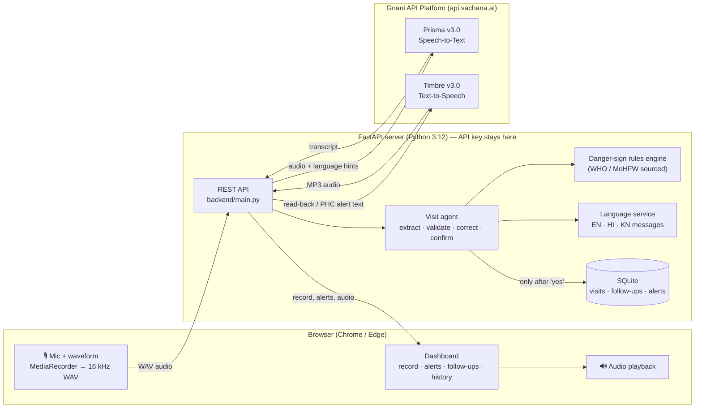

# ASHA VoiceMate

**Voice-first field register for ASHA workers** — Gnani Voice Hackathon, PS1 (Voice Field Register for ASHA Workers).

🔗 **Live demo:** https://asha-voicemate.onrender.com — open in Chrome or Edge and allow the microphone. (Free hosting: if it has been idle, the first load takes about a minute to wake up.)

An ASHA worker records a household visit **by speaking** in English, Hindi or Kannada (code-mixing allowed). ASHA VoiceMate transcribes it with **Gnani Prisma**, extracts a structured visit record, **reads it back with Gnani Timbre**, accepts **spoken corrections**, saves only after a spoken **“yes / haan / ಹೌದು”**, and **immediately speaks a PHC referral** when a predefined danger sign is heard.

## The problem
ASHA workers fill paper and app registers after long field days, often typing on small phones in a language they don't usually write. Records arrive late or incomplete, and a danger sign mentioned during a visit (bleeding in pregnancy, a newborn not feeding) can go unflagged.

## Features
- 🎙️ Speak the whole visit; no typing. Large mic button, live waveform.
- 🧾 Extracts Beneficiary ID, visit type (ANC / PNC / HBNC / Immunization), weight, vaccinations due, ANC / IFA / TT status, next visit date and notes.
- ❓ Asks again for missing or unclear details instead of guessing.
- 🔊 Reads the record back in the worker's language; spoken corrections (“No, weight is 2.8 kilo”) with full correction history.
- ✅ Saves to SQLite **only after explicit confirmation**; duplicate-safe; unsaved drafts survive a lost connection.
- 🚨 Deterministic danger-sign rules (WHO / MoHFW sources) → red alert + spoken “refer to PHC immediately”; uncertain speech → clarification + human review, never “safe”.
- 📋 Follow-up list (urgent referrals first) and searchable visit history.

## Architecture



**One spoken turn:** mic → WAV → **Gnani Prisma STT** → transcript → agent extracts fields + rules engine checks danger signs → if danger: alert text → **Gnani Timbre TTS** spoken first → read-back → **Gnani Timbre TTS** → worker corrects or says “yes” → saved to SQLite + follow-ups updated.

## Technology stack
Python 3.12 · FastAPI · SQLite · HTML / CSS / vanilla JavaScript · **Gnani API Platform** (Prisma v3.0 STT, Timbre v3.0 TTS) · pytest (109 tests)

> **Build status**
> | Part | Status |
> |---|---|
> | Danger-sign rules engine | ✅ built + tested |
> | Field extraction, voice corrections, confirmation flow | ✅ built + tested (on text transcripts) |
> | SQLite database (visits, follow-ups, alerts, demo beneficiaries) | ✅ built + tested |
> | FastAPI server + dashboard UI | ✅ built + tested (checked in browser) |
> | Microphone recording + waveform + WAV conversion | ✅ works (tested in Chrome) |
> | Gnani STT (Prisma v3.0) / TTS (Timbre v3.0) integration | ✅ **tested live on 2026-11-12**: TTS + STT in English, Hindi and Kannada, and a full voice visit (danger alert → spoken correction → spoken "yes" → saved). Note: in that test the spoken ID "B201" came back as "B-2001", so unknown IDs are now read aloud as a warning — speak IDs clearly, e.g. "B two zero one". |
>
> Languages: English (`en-IN`), Hindi (`hi-IN`) and Kannada (`kn-IN`) are confirmed in Gnani's official STT and TTS language lists.

## Gnani API Platform services used

| Service | Product | Used for |
|---|---|---|
| **Speech-to-Text** | **Gnani Prisma v3.0** (REST) | Turning every spoken visit note, correction and “yes/no” into text, with English + Hindi/Kannada code-mixing |
| **Text-to-Speech** | **Gnani Timbre v3.0** (REST), voice *Chetana* | Speaking the PHC referral alert, the record read-back, clarification questions and “saved” confirmation in the worker's language |

All details come from the official docs at **https://docs.gnani.ai** (read 2026-11-12). Nothing was guessed.

| | Speech-to-text | Text-to-speech |
|---|---|---|
| Model | Prisma v3.0 (`prisma-v3.0`) | Timbre v3.0 (`timbre-v3.0`), voice **Chetana** (“gentle, empathetic voice for healthcare”) |
| Endpoint | `POST https://api.vachana.ai/stt/v3` (multipart) | `POST https://api.vachana.ai/api/v1/tts/inference` (JSON) |
| Auth | `X-API-Key-ID` header | `X-API-Key-ID` header |
| What we send | 16 kHz mono WAV ≤ 30 s, `language_code` (`hi-IN,en-IN` / `kn-IN,en-IN` / `en-IN` so code-mixed terms like “IFA goli” survive), `format=transcribe` (numbers as digits), `keyterms` (ANC, IFA, TT, PHC, BCG…), `topic` | text, voice, language, speed 0.95, MP3 24 kHz 64k |
| Doc pages | `/api/STT/speech-to-text.md`, `/api/STT/languages.md` | `/api/TTS/tts-inference.md`, `/api/TTS/available-voices.md` |
| Code | `backend/services/gnani_stt.py` | `backend/services/gnani_tts.py` |

Design choices:
- **REST, not streaming.** The worker speaks one statement at a time, which fits the documented 30-second REST limit and is more robust on a weak connection. The realtime WebSocket API exists but is **not** used, so the transcript appears after each recording, not word by word.
- **Browser → WAV.** Browsers record WebM, which is not in Gnani's list (WAV, MP3, OGG, FLAC, AAC, M4A), so `app.js` converts each recording to 16 kHz mono WAV before upload.
- **One request at a time + one retry.** The docs say an account may allow only one active request (HTTP 429), so the server queues Gnani calls and retries once.
- **Readback dates** are spoken as “16 November 2026”, because Gnani's TTS guide warns that raw strings are mispronounced.
- The API key stays on the server. Audio is processed in memory and never saved.

### Test the real Gnani connection
1. Create `.env` (once): `Copy-Item .env.example .env`, then open it in VS Code and set `GNANI_API_KEY=` to your key from https://app.gnani.ai/voice/.
2. Restart the server. In the dashboard, hover over **STT** and **TTS**: they should say “key configured, not used yet”.
3. Type `ID B205 newborn visit weight 2.8 kilo next visit Monday` in the test box and press Enter → you should **hear** the read-back. TTS light turns green (“working”).
4. Press the microphone, say the same sentence, press again → the transcript appears tagged **Gnani STT**. STT light turns green.
5. Repeat step 4 in Hindi and Kannada after switching the language.
6. If a light turns red, hover over it: it shows Gnani's error (e.g. invalid key, no credit, key not allowed for STT/TTS).

---

## Project structure

```
ASHA-VoiceMate/
  backend/
    main.py                 FastAPI server: pages + /api/* routes
    models.py               input validation for every request
    config.py               settings, reads .env (API key never sent to browser)
    database.py             SQLite tables + save/search functions
    services/
      danger_signs.py       deterministic danger-sign rules (with sources)
      agent.py              extracts fields, handles corrections + confirmation
      language_service.py   all spoken/displayed text per language
      gnani_client.py       shared Gnani auth, errors, retry, one-at-a-time queue
      gnani_stt.py          Gnani Prisma v3.0 speech-to-text (REST)
      gnani_tts.py          Gnani Timbre v3.0 text-to-speech (REST)
    tests/                  109 tests (rules, agent, database, API, Gnani request format)
  frontend/
    index.html              dashboard layout
    style.css               dark navy / teal design, responsive
    app.js                  mic, waveform, API calls, alerts, drafts
  data/                     SQLite file is created here
  .env.example              copy to .env and add your key
  requirements.txt
```

## Setup (Windows PowerShell)

Run these one at a time inside the `ASHA-VoiceMate` folder:

```powershell
py -3.12 -m venv .venv
```
```powershell
.\.venv\Scripts\python.exe -m pip install -r requirements.txt
```
```powershell
Copy-Item .env.example .env
```
Then open `.env` in VS Code and replace the placeholder with your Gnani key. **Never paste the key into chat or commit `.env`.**

## Run the app

```powershell
.\.venv\Scripts\python.exe -m uvicorn backend.main:app --reload --port 8000
```
Wait for `Uvicorn running on http://127.0.0.1:8000`, then open **http://localhost:8000** in Chrome or Edge. Press `Ctrl+C` in PowerShell to stop.

### Using the dashboard
- **Language selector** (top right): English, Hindi, Kannada (all confirmed in Gnani's language lists).
- **Microphone**: tap to record, tap again to stop (max 29 seconds per recording).
- **Test input box**: type what the worker said (or click an example chip) and press Enter. This uses exactly the same server pipeline as speech.
- **Visit record**: amber = needed, red = unclear (please repeat), blue flash = just changed.
- **Danger alert**: red banner = refer to PHC immediately; amber = possible sign, clarification + human review.
- **Confirm & save** or say “yes / haan / ಹೌದು”. Nothing is saved before this.
- **Follow-ups**: urgent referrals first; tick to mark done. **Recent visits**: search and click to see full details, alerts, transcript and corrections.
- If the connection drops, the draft is kept on the device and can be restored; a failed save can be retried without creating a duplicate.

### Demo script (speak each line with the mic, or type it in the test box)
1. `ID B205 newborn visit, weight 2.5 kilo, BCG and OPV due, next visit after 7 days` → read-back + confirmation question.
2. `No, weight is 2.8 kilo.` → “Corrected”, weight flashes, correction history shows 2.5 → 2.8.
3. `Change the next visit date to Friday.` → date updated.
4. `yes` → saved, follow-up appears.
5. **New visit** → `ID B201 newborn visit weight 2.6 kg, baby is not feeding and has fever, next visit tomorrow` → red PHC referral alert → `yes` → saved as URGENT REFERRAL, urgent follow-up on top.
6. **New visit** → `ID B101 ANC visit, ANC done, IFA given, TT given, next visit Monday` then `maybe there is some bleeding` → amber clarification alert.

## Run the tests

```powershell
.\.venv\Scripts\python.exe -m pytest -v
```
Expected last line: `109 passed`.

## Deploy (free, on Render)

The repo includes `render.yaml`, so Render can set everything up from GitHub. Render gives the app an **HTTPS** address, which browsers require for the microphone.

1. Sign in at **https://render.com** with your GitHub account.
2. **New + → Blueprint** → select this repository → **Apply**.
3. When Render asks for **`GNANI_API_KEY`**, paste your Gnani key (it is stored on Render only, never in GitHub).
4. Wait for the build (about 3–5 minutes), then open the `https://…onrender.com` link in Chrome and allow the microphone.

Free-plan notes: the app sleeps after about 15 minutes without visitors (the first visit then takes about a minute to wake it); saved visits are reset whenever the app restarts; anyone with the link uses your Gnani credits, so share it only with judges.

## How a visit works

1. Worker picks a language and speaks the visit.
2. Transcript → `agent.extract_fields` → structured record. Anything not clearly said is left empty or marked **unclear** — the system asks again instead of guessing.
3. Every utterance also goes through `danger_signs.detect_danger_signs`. A clear danger sign produces an `alert_text` that is spoken **first**: “Danger sign: … Refer to the PHC immediately.”
4. When all required fields are present the record is read back and the worker is asked to confirm.
5. Anything the worker says that contains a field value is treated as a **correction** (even if it starts with “yes”) and is read back again. Every change is kept in `correction_history`.
6. Only a plain “yes / haan / ಹೌದು” saves. Saving twice with the same request ID never creates a duplicate.

Required fields: Beneficiary ID, visit type, next visit date; plus ANC/IFA/TT status for ANC visits, weight for newborn/immunization visits, vaccination status for immunization visits.

## Danger-sign rules and official references

The engine **does not diagnose, recommend medicines or give treatment advice**. Its only instruction is to refer to the PHC.

| Rule ID | Danger sign | Applies to | Source(s) |
|---|---|---|---|
| BLEEDING | Vaginal bleeding in pregnancy / heavy bleeding after delivery | Mother | [2], [3] |
| CONVULSIONS | Convulsions / fits | Mother or newborn | [1], [2], [4] |
| HEADACHE_BLURRED_VISION | Severe headache with blurred vision | Pregnancy | [2], [3] |
| HIGH_FEVER_MOTHER | High fever | Pregnant / postpartum woman | [2], [3] |
| NEWBORN_FEVER | Fever, temperature ≥ 37.5 °C | Newborn | [1], [4] |
| NEWBORN_LOW_TEMPERATURE | Temperature < 35.5 °C / cold to touch | Newborn | [1], [4] |
| NEWBORN_NOT_FEEDING | Not feeding well / stopped feeding | Newborn | [1], [4] |
| BREATHING_DIFFICULTY | Fast/difficult breathing (newborn ≥ 60/min), severe chest indrawing | Mother or newborn | [1], [2], [4] |
| NEWBORN_NO_MOVEMENT | Moves only when stimulated / no movement | Newborn | [1], [4] |
| SEVERE_ABDOMINAL_PAIN | Severe abdominal pain | Pregnancy | [2], [3] |
| SWELLING_FACE_HANDS | Swelling of face or hands | Pregnancy | [3], [2] |
| REDUCED_FETAL_MOVEMENT | Reduced / absent fetal movement | Pregnancy | [3] |
| LEAKING_FLUID | Leaking of watery fluid | Pregnancy | [3] |
| FOUL_DISCHARGE | Foul-smelling vaginal discharge | After delivery | [2], [3] |

References:
1. WHO & UNICEF. *Home visits for the newborn child: a strategy to improve survival.* Joint Statement, 2009 — list of seven newborn danger signs.
2. WHO. *Pregnancy, Childbirth, Postpartum and Newborn Care: A guide for essential practice*, 3rd ed., 2015 — danger signs for the woman.
3. Ministry of Health & Family Welfare, Govt. of India. *Mother and Child Protection (MCP) Card* — danger signs in pregnancy and after delivery.
4. Ministry of Health & Family Welfare, Govt. of India. *Home Based Newborn Care (HBNC) Operational Guidelines*, 2014 — newborn danger signs for ASHA referral.

> ⚠️ **Must verify before submission:** the list above was compiled from these documents by the developer. The exact page/section numbers have **not yet been checked** against the PDFs. Before the demo, open each document and add the page number next to each rule, and remove any rule you cannot find in the source.

### How uncertainty is handled (never “safe” by default)

| Result | When | What happens |
|---|---|---|
| `danger` | Clear mention of a listed sign | Red alert, PHC referral spoken in selected language, record flagged `urgent_referral`, urgent follow-up created |
| `clarify` | Hedged speech (“maybe”, “shayad”), unclear severity (“pet dard”), or missing context (“fever” — is it the newborn?) | Amber alert, worker asked to clarify, record flagged `needs_human_review`, supervisor follow-up created |
| `negated` | Worker says the sign is absent (“no bleeding”, “ಜ್ವರ ಇಲ್ಲ”) | Not dropped — read back aloud (“Recorded as absent: bleeding”) for confirmation |
| none | Nothing from the list heard | Shown as “No predefined danger sign detected (this is NOT a safety clearance)” |

Phrases like “khoon nahi ruk raha” (bleeding not stopping) are treated as **danger**, not as negation. “Khoon ki kami” (anaemia) and “ghar ka daura” (house visit) are **not** flagged.

## Safety limitations (honest list)

- Keyword rules can miss unusual phrasing or STT errors. The tool supports, it does not replace, the worker's own judgement and training.
- Hindi and Kannada phrases/messages were written by the developer and need native-speaker review.
- Spoken numbers are converted for English only (“two point eight”); Hindi/Kannada number words are not yet converted.
- All beneficiary data is synthetic. No audio is stored.

